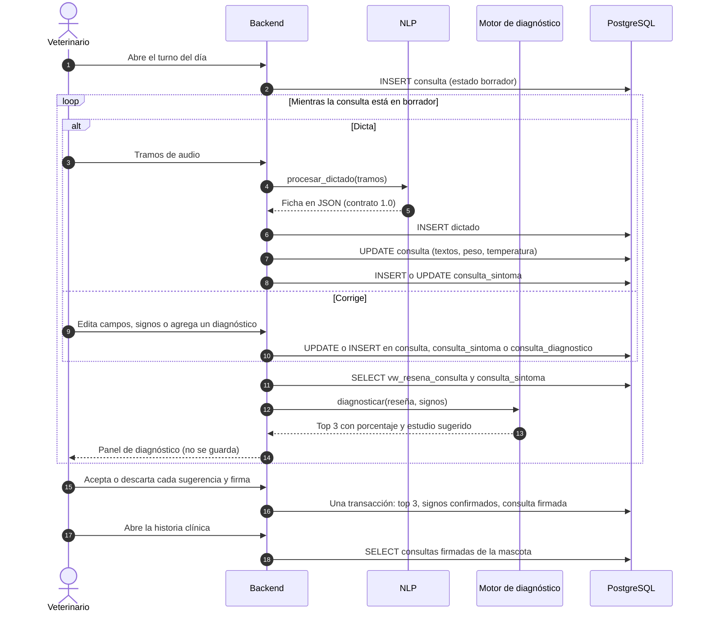
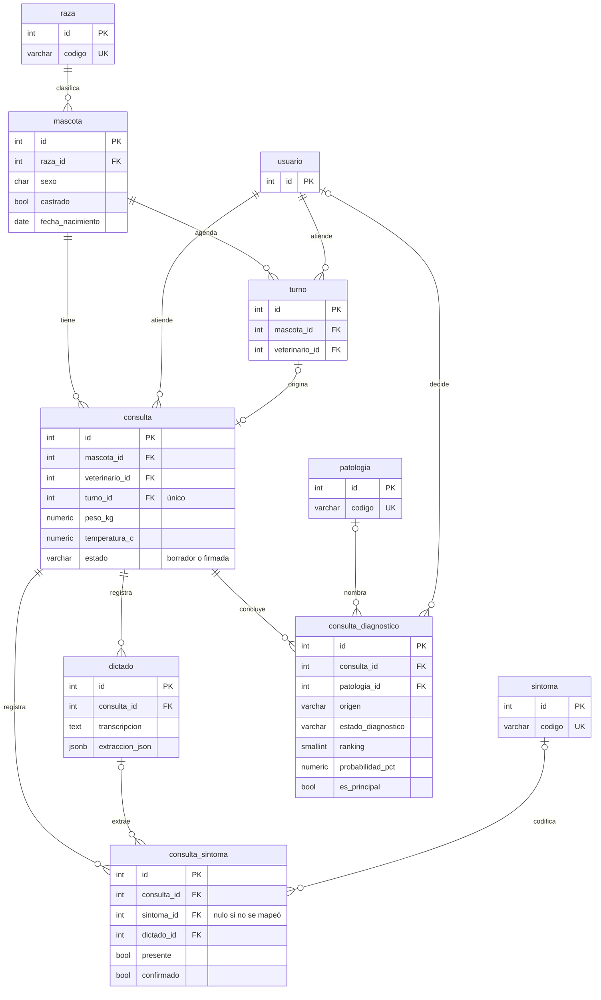
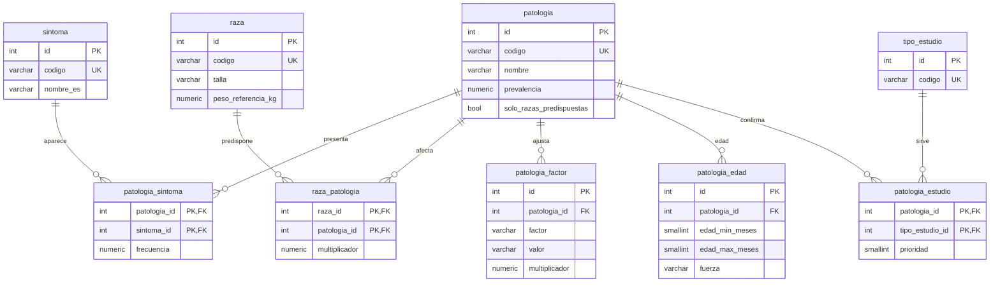

## Tablas

| Tabla | Grupo | Qué guarda | Quién la escribe y cuándo |
| --- | --- | --- | --- |
| `auth.usuario` | Existente | Los usuarios; el flujo usa al veterinario | Nadie en el flujo: solo se lee |
| `agenda.turno` | Existente | Los turnos de la agenda | La agenda; al firmar, el flujo lo marca como atendido |
| `clinica.mascota` | Existente | El paciente: raza, sexo, castración y nacimiento | Nadie en el flujo: solo se lee |
| `clinica.raza` | Existente | Las razas, con su talla y sus pesos | La app; el flujo solo la lee |
| `clinica.sintoma` | Base de conocimiento | El catálogo de 97 signos que comparten el NLP y el motor | La carga inicial; después solo se lee |
| `clinica.patologia` | Base de conocimiento | Las patologías candidatas y su prevalencia | La carga inicial; después solo se lee |
| `clinica.patologia_sintoma` | Base de conocimiento | Con qué frecuencia aparece cada signo en cada patología | La carga inicial; después solo se lee |
| `clinica.raza_patologia` | Base de conocimiento | La predisposición de cada raza | La carga inicial; después solo se lee |
| `clinica.patologia_factor` | Base de conocimiento | Ajustes por sexo, castración, talla y peso | La carga inicial; después solo se lee |
| `clinica.patologia_edad` | Base de conocimiento | Las ventanas de edad típica | La carga inicial; después solo se lee |
| `clinica.tipo_estudio` | Base de conocimiento | Los estudios que se pueden sugerir | La carga inicial; después solo se lee |
| `clinica.patologia_estudio` | Base de conocimiento | Qué estudio confirma cada patología | La carga inicial; después solo se lee |
| `clinica.consulta` | Historia clínica | La consulta: textos, peso, temperatura y estado | El backend: al abrir, en cada dictado, en cada corrección y al firmar |
| `clinica.dictado` | Historia clínica | Lo que entendió el NLP, sin corregir | El backend, una fila por dictado; nunca se edita |
| `clinica.consulta_sintoma` | Historia clínica | Los signos de la consulta, presentes o negados | El backend, en cada dictado y en cada corrección; al firmar quedan confirmados |
| `clinica.consulta_diagnostico` | Historia clínica | El top 3 con la decisión del veterinario y el diagnóstico final | El backend, al firmar; un diagnóstico manual, en el momento en que se agrega |
| `clinica.vw_resena_consulta` | Vista | Lo que el motor necesita saber del paciente | Nadie: se calcula cada vez que se lee |

## 1. Recorrido

Se abre una consulta en borrador y se cierra con la firma. En el medio hay un bucle que se repite las veces que haga falta, porque el veterinario puede dictar más de una vez y puede corregir lo que entendió el NLP. Después de cada dictado o corrección, el backend vuelve a calcular el top 3 y lo muestra en el panel, pero ese cálculo no se guarda, se descarta en cuanto llega el siguiente.



 Los dictados completan un borrador, el veterinario lo corrige y el top 3 se recalcula en vivo, sin escribir en `consulta_diagnostico`. La firma hace en una sola transacción las tres cosas que convierten el borrador en historia clínica: guarda el top 3 con la decisión del veterinario, marca los signos como confirmados y pasa la consulta a solo lectura. Por eso una consulta firmada conserva no solo el diagnóstico, sino también la evidencia que lo produjo y lo que el sistema sugirió en ese momento.

## 2. Cómo se relacionan las tablas

Todo lo que produce la atención cuelga de `consulta`, que a su vez pertenece a una `mascota` y a un `veterinario` y, si vino de la `agenda`, a un `turno`.



`consulta` tiene tres tablas hijas, una por cada cosa que produce la atención. 
* `dictado` guarda una fila por grabación, tal como la devolvió el NLP. 
* `consulta_sintoma` guarda una fila por signo, y cada fila sabe de qué dictado salió, o que se cargó a mano. 
* `consulta_diagnostico` guarda el top 3 que quedó al firmar y cualquier diagnóstico manual. 

Las dos últimas son las que se conectan con la base de conocimiento: `consulta_sintoma` apunta a `sintoma` y `consulta_diagnostico` apunta a `patologia`.

Luego hay un diagrama que gira alrededor de `patologia`.



Cada tabla que rodea a `patologia` aporta un término del cálculo del motor: 
* `patologia_sintoma` la frecuencia de cada signo
* `raza_patologia` la predisposición de la raza
* `patologia_factor` los ajustes por sexo, castración, talla y peso
* `patologia_edad` las ventanas de edad
* `patologia_estudio` el estudio que confirmaría cada patología.

Los dos diagramas se tocan en tres tablas: `sintoma`, `patologia` y `raza`. Los puentes que importan, sin embargo, son dos códigos de texto. 

`sintoma.codigo` es el código que escribe el NLP y que busca el motor. `patologia.codigo` es el que devuelve el motor en el top 3, y con él se arma cada fila de `consulta_diagnostico` al firmar. Los módulos se pasan códigos y nunca ids

## 3. La vista

La vista `vw_resena_consulta` resuelve todo lo que el motor necesita saber del paciente a la fecha de esa consulta: raza, talla, sexo, castración, edad en meses y clase de peso relativo, calculada con el peso del día o, si en esta consulta no se dictó, con el último conocido. Los signos sin código no entran: el panel avisa cuántos quedaron afuera, y por eso conviene resolverlos antes de firmar.

Con esa entrada, el motor calcula un puntaje para cada patología de la base y los normaliza para que sumen 100 %:

```text
puntaje(p) = prevalencia(p)                                  patologia
           × multiplicador de raza(p)                        raza_patologia (1 si no hay fila)
           × multiplicadores de los factores que coinciden   patologia_factor (0 la excluye)
           × ajuste por edad(p)                              patologia_edad
           × frecuencia(p, s) de cada signo presente         patologia_sintoma (0,02 si no hay fila)
           × (1 − frecuencia(p, s)) de cada signo negado     patologia_sintoma (0,02 si no hay fila)
```

Cada renglón sale de una tabla, y entenderlo explica por qué importa la diferencia entre un signo negado y uno no mencionado. Un signo presente multiplica por su frecuencia en esa patología; uno negado, por la probabilidad de que no aparezca; uno que no se mencionó no cuenta. 

## 4. Historia clínica

La historia clínica de una mascota es la lista de sus consultas firmadas, cada una con su diagnóstico principal. Al abrir una, se muestran sus campos, sus signos y sus diagnósticos, todos de solo lectura.

```sql
SELECT c.fecha_hora, c.motivo, c.peso_kg, c.temperatura_c,
       COALESCE(p.nombre, d.descripcion_libre) AS diagnostico_principal
FROM clinica.consulta c
LEFT JOIN clinica.consulta_diagnostico d ON d.consulta_id = c.id AND d.es_principal
LEFT JOIN clinica.patologia p ON p.id = d.patologia_id
WHERE c.mascota_id = :mascota_id AND c.estado = 'firmada'
ORDER BY c.fecha_hora DESC;
```

### 4.1 `clinica.consulta`

La consulta es el centro del flujo. Nace en borrador cuando se abre el turno, el NLP y el veterinario la completan, y la firma la cierra.

| Columna | Tipo | Nulo | Por defecto | Para qué sirve |
| --- | --- | --- | --- | --- |
| `id` | integer | no | autonumérico | Identificador. |
| `mascota_id` | integer | no |  | El paciente. |
| `veterinario_id` | integer | no |  | Quién atiende. |
| `turno_id` | integer | sí |  | El turno que originó la consulta. Único: una consulta por turno. Opcional: admite pacientes sin turno. |
| `fecha_hora` | timestamptz | no |  | Cuándo se atendió. La edad del paciente se calcula a esta fecha. |
| `motivo` | text | sí |  | Por qué consultan. Lo completa el NLP y el veterinario lo puede editar. |
| `anamnesis` | text | sí |  | Lo que relata el propietario y la historia previa. Lo completa el NLP. |
| `examen_fisico` | text | sí |  | Lo que el veterinario observa, palpa o mide, en texto libre. Lo completa el NLP. |
| `peso_kg` | numeric(5,2) | sí |  | **Nueva.** Peso del día, entre 0 y 150. El motor lo compara con el peso de referencia de la raza. |
| `temperatura_c` | numeric(4,1) | sí |  | **Nueva.** Temperatura del día, entre 30 y 45. El motor puede derivar fiebre de ella. |
| `tratamiento` | text | sí |  | Indicaciones, medicación y controles. Lo completa el NLP. |
| `observaciones` | text | sí |  | Estudios pedidos y otras notas. Lo completa el NLP. |
| `estado` | varchar(20) | no | `'borrador'` | `borrador` mientras se edita; `firmada` cuando se cierra y pasa a solo lectura. **Cambia:** ahora es obligatorio. |
| `consulta_padre_id` | integer | sí |  | Solo para un addendum de una consulta firmada. En el prototipo no se usa. |
| `fecha_firma` | timestamptz | sí |  | Cuándo se firmó. Tiene valor si y solo si el estado es `firmada`. |
| `fecha_creacion` | timestamptz | sí | `now()` | Alta del registro. |
| `fecha_modificacion` | timestamptz | sí |  | Última edición. La completa el backend. |

`estado` solo admite `borrador` o `firmada`, y la restricción `ck_consulta_firma` obliga a que `fecha_firma` tenga valor si y solo si la consulta está firmada, así que una consulta firmada siempre sabe cuándo se firmó. Los rangos de `peso_kg` y `temperatura_c` dejan afuera valores imposibles, como los que produciría un error de transcripción («380 grados»). El índice `ix_consulta_mascota_fecha` es el que usan la historia clínica y la búsqueda del último peso conocido.

### 4.2 `clinica.dictado`

Una fila por grabación ya procesada, con lo que entendió el NLP antes de cualquier corrección.

| Columna | Tipo | Nulo | Por defecto | Para qué sirve |
| --- | --- | --- | --- | --- |
| `id` | integer | no | autonumérico | Identificador. |
| `consulta_id` | integer | no |  | La consulta en la que se dictó. |
| `transcripcion` | text | no |  | El texto que devolvió whisper.cpp. |
| `extraccion_json` | jsonb | no |  | La ficha completa que devolvió el NLP (contrato 1.0), sin ninguna corrección del veterinario. |
| `modelo_stt` | varchar(60) | no |  | Modelo de transcripción, por ejemplo `whisper.cpp/small-q5_1`. Vale `texto` cuando la ficha salió de un texto, sin audio (pruebas). |
| `modelo_llm` | varchar(60) | sí |  | Modelo de extracción (`claude-haiku-5-5`). Nulo si se usó el extractor por reglas. |
| `version_prompt` | varchar(20) | sí |  | Versión de las instrucciones del extractor, para comparar cambios. |
| `duracion_audio_s` | numeric(6,1) | sí |  | Segundos de audio dictado. |
| `latencia_stt_ms` | integer | sí |  | Cuánto tardó la transcripción. |
| `latencia_llm_ms` | integer | sí |  | Cuánto tardó la extracción. |
| `fecha_creacion` | timestamptz | no | `now()` | Cuándo se procesó. |

Es de solo escritura: no tiene pantallas y no se edita. `extraccion_json` guarda la ficha entera (campos, signos y textos no mapeados) aunque partes de ella ya estén en otras tablas, porque es la única copia de lo que entendió el NLP antes de que el veterinario lo corrigiera. El audio no se guarda en la base. Si la transcripción falla, no se guarda nada: el error vuelve a la pantalla y el veterinario repite el dictado. Si falla Claude, el NLP en modo automático sigue con el extractor por reglas, y `modelo_llm` queda nulo.

### 4.3 `clinica.consulta_sintoma`

Los signos de la consulta. Es la salida principal del NLP, la tabla que el veterinario corrige y la única entrada del motor además de la reseña.

| Columna | Tipo | Nulo | Por defecto | Para qué sirve |
| --- | --- | --- | --- | --- |
| `id` | integer | no | autonumérico | Identificador. |
| `consulta_id` | integer | no |  | La consulta. |
| `sintoma_id` | integer | sí |  | El signo del catálogo. Nulo cuando el NLP no lo pudo mapear: queda para que el veterinario lo resuelva. |
| `dictado_id` | integer | sí |  | De qué dictado salió. Nulo si se cargó a mano; si se borra el dictado, también queda nulo. |
| `texto_original` | varchar(255) | no |  | El fragmento tal como se dictó (por ejemplo «no vomita ni tiene diarrea»). |
| `presente` | boolean | no | `true` | `true` si está presente, `false` si se negó explícitamente. El motor usa las dos cosas. |
| `origen` | varchar(10) | no | `'nlp'` | `nlp` o `manual`. |
| `confirmado` | boolean | no | `false` | `true` cuando el veterinario lo revisó. Al firmar pasan todos a `true`. Un dictado posterior nunca pisa un signo confirmado. |
| `fecha_creacion` | timestamptz | no | `now()` | Alta del registro. |

El índice único `uq_consulta_sintoma` permite una sola fila por signo en cada consulta, pero solo entre las filas con código: los textos no mapeados pueden ser varios. Una fila con `presente = false` es un signo negado explícitamente («no vomita»), que no es lo mismo que un signo que no se mencionó, el cual directamente no tiene fila. Si se borra la consulta se borran sus signos; si se borra un dictado, sus signos quedan, con `dictado_id` nulo.

### 4.4 `clinica.consulta_diagnostico`

Une en una sola tabla las sugerencias del motor y el diagnóstico final, distinguidos por `origen`. Las sugerencias se escriben al firmar; los diagnósticos manuales, cuando se agregan.

| Columna | Tipo | Nulo | Por defecto | Para qué sirve |
| --- | --- | --- | --- | --- |
| `id` | integer | no | autonumérico | Identificador. |
| `consulta_id` | integer | no |  | La consulta. |
| `patologia_id` | integer | sí |  | La patología del catálogo. Obligatoria en las sugerencias de la IA; opcional en un diagnóstico manual. |
| `descripcion_libre` | varchar(255) | sí |  | Diagnóstico escrito a mano cuando no está en el catálogo. |
| `origen` | varchar(20) | no | `'manual'` | `manual` o `sugerido_ia`. **Cambia:** ahora es obligatorio. |
| `estado_diagnostico` | varchar(20) | no | `'pendiente'` | `pendiente` (el veterinario no decidió), `aceptado` o `rechazado`. Un manual siempre es `aceptado`. **Cambia:** obligatorio y con valor por defecto. |
| `ranking` | smallint | sí |  | **Nueva.** Puesto en el top 3, de 1 a 3. |
| `probabilidad_pct` | numeric(5,2) | sí |  | **Nueva.** El porcentaje que mostró el motor, de 0 a 100. |
| `explicacion` | jsonb | sí |  | **Nueva.** JSON con el aporte de cada factor y de cada signo al porcentaje. |
| `version_motor` | varchar(20) | sí |  | **Nueva.** Versión del motor y de la base con que se calculó, para poder reproducirlo. |
| `es_principal` | boolean | no | `false` | **Nueva.** Marca el diagnóstico final. Uno solo por consulta, y tiene que estar `aceptado`. |
| `confirmado_por_usuario_id` | integer | sí |  | Quién decidió. Nulo en las sugerencias que quedaron pendientes. |
| `fecha_decision` | timestamptz | sí |  | **Nueva.** Cuándo se aceptó o rechazó. |
| `fecha_creacion` | timestamptz | sí | `now()` | Alta del registro. |

Las restricciones impiden las filas incoherentes. `ck_dx_contenido` exige una patología o una descripción; `ck_dx_ia` exige que una sugerencia tenga patología, ranking y porcentaje; `ck_dx_manual` obliga a que un diagnóstico manual esté aceptado, y `ck_dx_principal` a que el principal también lo esté. Los índices únicos `uq_dx_ranking` y `uq_dx_principal` garantizan un solo ranking 1, 2 y 3 por consulta y un solo principal. La clave hacia `consulta` no tiene `ON DELETE CASCADE`, así como la propuso el compañero: una consulta con diagnósticos no se puede borrar, que es lo correcto para una firmada; para descartar un borrador que tenga un diagnóstico manual, el backend borra primero el diagnóstico.

`explicacion` guarda el aporte de cada término al porcentaje. Su forma la define quien hace el motor; para la primera sugerencia de Coco, con la forma que usa el motor del proyecto, sería esta:

```json
{
  "prevalencia": 0.01,
  "raza": {"codigo": "french-bulldog", "multiplicador": 2.5},
  "factores": [],
  "edad": null,
  "sintomas_presentes": [
    {"codigo": "estertor_ronquido", "frecuencia": 0.5, "sin_fila": false},
    {"codigo": "intolerancia_ejercicio", "frecuencia": 0.5, "sin_fila": false},
    {"codigo": "regurgitacion", "frecuencia": 0.02, "sin_fila": true},
    {"codigo": "cianosis", "frecuencia": 0.02, "sin_fila": true},
    {"codigo": "tos", "frecuencia": 0.5, "sin_fila": false},
    {"codigo": "soplo_cardiaco", "frecuencia": 0.02, "sin_fila": true},
    {"codigo": "disnea", "frecuencia": 0.5, "sin_fila": false}
  ],
  "sintomas_negados": [
    {"codigo": "sincope", "frecuencia": 0.5, "sin_fila": false}
  ]
}
```

`sin_fila: true` marca los signos que la base no relaciona con esa patología y que entraron con el 0,02 por defecto. Acá son regurgitación, cianosis y soplo: conviene revisar con un veterinario si alguno debería estar relacionado con el síndrome braquicefálico. Además de servir en la defensa para explicar por qué salió cada sugerencia, la explicación es la herramienta más directa para encontrar huecos en la base.

### 4.5 La vista `clinica.vw_resena_consulta`

Resume en una fila por consulta lo que el motor necesita saber del paciente. Es una vista y no una tabla porque todo lo que muestra se deriva de otras tablas, y así nunca queda desactualizada.

| Columna | Tipo | Para qué sirve |
| --- | --- | --- |
| `consulta_id` | integer | La consulta. |
| `fecha_hora` | timestamptz | Cuándo fue la consulta; la edad se calcula a esta fecha. |
| `mascota_id` | integer | El paciente. |
| `temperatura_c` | numeric(4,1) | La temperatura del día, de la que el motor deriva fiebre. |
| `raza_codigo` | varchar(60) | El código de la raza, con el que el motor busca en `raza_patologia`. |
| `talla` | varchar(10) | La talla de la raza. Es un factor. |
| `peso_referencia_kg` | numeric(5,2) | El peso típico de un adulto de la raza. |
| `sexo` | char(1) | Es un factor. |
| `castrado` | boolean | Es un factor; el motor lo pasa a `si` o `no`. |
| `edad_meses` | integer | Meses cumplidos a la fecha de la consulta. |
| `peso_kg` | numeric(5,2) | El peso de esta consulta o, si no se dictó, el último conocido de la mascota. |
| `indice_peso` | numeric | `peso_kg / peso_referencia_kg`. Nulo en cachorros. |
| `peso_relativo` | text | `bajo` (índice menor a 0,8), `normal` (hasta 1,15), `sobrepeso` (hasta 1,35) u `obesidad`. Nulo si no hay peso o si es un cachorro. |

```sql
CREATE VIEW clinica.vw_resena_consulta AS
WITH base AS (
  SELECT c.id AS consulta_id, c.fecha_hora, c.mascota_id, c.temperatura_c,
         r.codigo AS raza_codigo, r.talla, r.peso_referencia_kg, m.sexo, m.castrado,
         (date_part('year', age(c.fecha_hora::date, m.fecha_nacimiento)) * 12
          + date_part('month', age(c.fecha_hora::date, m.fecha_nacimiento)))::int AS edad_meses,
         COALESCE(c.peso_kg, (SELECT c2.peso_kg FROM clinica.consulta c2
                              WHERE c2.mascota_id = c.mascota_id AND c2.peso_kg IS NOT NULL
                                AND c2.fecha_hora < c.fecha_hora
                              ORDER BY c2.fecha_hora DESC LIMIT 1)) AS peso_kg
  FROM clinica.consulta c
  JOIN clinica.mascota m ON m.id = c.mascota_id
  JOIN clinica.raza r    ON r.id = m.raza_id
)
-- El peso de referencia es el de un adulto: en cachorros (menos de 12 meses) no se calcula.
SELECT base.*,
       CASE WHEN edad_meses >= 12 THEN round(peso_kg / peso_referencia_kg, 2) END AS indice_peso,
       CASE WHEN peso_kg IS NULL OR coalesce(edad_meses, 0) < 12 THEN NULL
            WHEN peso_kg / peso_referencia_kg < 0.80   THEN 'bajo'
            WHEN peso_kg / peso_referencia_kg < 1.15   THEN 'normal'
            WHEN peso_kg / peso_referencia_kg < 1.35   THEN 'sobrepeso'
            ELSE 'obesidad' END AS peso_relativo
FROM base;
```

El peso merece una explicación. Con una columna `peso_kg` en la consulta, el historial de peso de una mascota es la serie de sus consultas, sin otra tabla; por eso, si en la consulta de hoy no se dictó el peso, la vista toma el último conocido. Y como el peso de referencia es el de un adulto, en un cachorro el índice no significa nada: un ovejero alemán de cuatro meses con 12 kilos daría «bajo» solo porque todavía no terminó de crecer. Por eso la vista no calcula el peso relativo antes de los 12 meses, y en ese caso el motor omite ese factor.

## 5. Base de conocimiento

Son ocho tablas que se cargan una sola vez desde `kb_canina` y durante la consulta solo se leen. Quien hace el diagnóstico puede ajustarlas, con una condición: `sintoma.codigo` y `patologia.codigo` no pueden cambiar, porque son lo que leen los otros dos módulos.

### 5.1 `clinica.sintoma`

El catálogo de signos, y la única tabla que usan los tres módulos: el NLP escribe sus códigos, el veterinario elige de ella cuando agrega un signo a mano y el motor busca sus frecuencias. Los 97 códigos son los mismos de `catalogo_signos.csv`, que además agrega 536 formas de decir cada signo en rioplatense; esas formas viven solo en el CSV, porque solo las usa el NLP.

| Columna | Tipo | Nulo | Por defecto | Para qué sirve |
| --- | --- | --- | --- | --- |
| `id` | integer | no | autonumérico | Identificador. |
| `codigo` | varchar(40) | no |  | El código que comparten el NLP y el motor; es el mismo de `catalogo_signos.csv`. No se cambia nunca. |
| `nombre_es` | varchar(80) | no |  | Nombre para mostrar. |
| `sistema` | varchar(20) | no |  | Piel, ojo, digestivo, respiratorio, etc. Sirve para agrupar en pantalla. |
| `tipo` | varchar(12) | no |  | `observable` si lo cuenta el dueño, `examen` si lo encuentra el veterinario. |
| `activo` | boolean | no | `true` | Para retirar un signo sin borrarlo. |

### 5.2 `clinica.patologia`

Las patologías candidatas. `prevalencia` es el punto de partida de todo el cálculo y, como advierte el README de `kb_canina`, es una estimación propia y el número que más conviene validar con un veterinario: decide qué patología sube primero cuando los signos no alcanzan para distinguir. `solo_razas_predispuestas` es la única columna que propone este documento; la sección 5.9 explica por qué.

| Columna | Tipo | Nulo | Por defecto | Para qué sirve |
| --- | --- | --- | --- | --- |
| `id` | integer | no | autonumérico | Identificador. |
| `codigo` | varchar(100) | no |  | Código estable, el slug de la CIDD. |
| `nombre` | varchar(160) | no |  | Nombre en español. |
| `nombre_en` | varchar(160) | sí |  | Nombre original de la fuente. |
| `categoria` | varchar(80) | sí |  | Grupo de la CIDD (trastornos de piel, de ojos, etc.). |
| `prevalencia` | numeric(6,5) | no |  | Probabilidad base en perros, entre 0 y 1. Es el punto de partida del cálculo. |
| `prevalencia_nivel` | varchar(20) | no |  | La misma prevalencia en palabras, para revisarla con un veterinario. |
| `solo_razas_predispuestas` | boolean | no | `false` | **Propuesta.** `true` en las patologías que dependen de la conformación (síndrome braquicefálico, pliegues, etc.): el motor solo las considera en razas que las tengan en `raza_patologia`. |
| `activo` | boolean | no | `true` | Para retirar una patología sin borrarla. |

### 5.3 `clinica.patologia_sintoma`

Relaciona cada patología con sus signos y con la probabilidad de verlos. Es la tabla que más pesa en el resultado y también la menos revisada: de las 348 filas cargadas para las cinco razas, 272 tienen origen `auto`, es decir que las extrajo un script del texto de la CIDD y todavía nadie las revisó.

| Columna | Tipo | Nulo | Por defecto | Para qué sirve |
| --- | --- | --- | --- | --- |
| `patologia_id` | integer | no |  | La patología. |
| `sintoma_id` | integer | no |  | El signo. |
| `frecuencia` | numeric(4,3) | no |  | Probabilidad de ver el signo si el perro tiene la patología: 0,8, 0,5, 0,2 o 0,05. |
| `frecuencia_nivel` | varchar(15) | no |  | La misma frecuencia en palabras: `muy_frecuente`, `frecuente`, `ocasional` o `raro`. |
| `origen` | varchar(10) | no |  | `cidd` si lo dice la fuente, `clinico` si es criterio clínico, `auto` si se extrajo automáticamente y falta revisarlo. |

### 5.4 `clinica.raza_patologia`

La predisposición de cada raza a cada patología, convertida en un multiplicador según cómo la registra la CIDD.

| Columna | Tipo | Nulo | Por defecto | Para qué sirve |
| --- | --- | --- | --- | --- |
| `raza_id` | integer | no |  | La raza. |
| `patologia_id` | integer | no |  | La patología a la que está predispuesta. |
| `categoria` | varchar(20) | no |  | Cómo la registra la CIDD: `most_important`, `mayor_incidencia`, `conformacion`, `esporadico` o `solo_en_desorden`. |
| `multiplicador` | numeric(4,2) | no |  | Cuánto multiplica la probabilidad en esa raza: 4 para `most_important`, 2,5 para `mayor_incidencia` y `conformacion`, 2 para `solo_en_desorden` y 1,5 para `esporadico`. Sin fila, la raza no cambia nada (1). |

### 5.5 `clinica.patologia_factor`

Los ajustes por la reseña. Cada fila dice: si el paciente tiene este valor, multiplicar por tanto. Un multiplicador 0 excluye la patología, por ejemplo un trastorno que solo afecta a machos en una paciente hembra.

| Columna | Tipo | Nulo | Por defecto | Para qué sirve |
| --- | --- | --- | --- | --- |
| `id` | integer | no | autonumérico | Identificador. |
| `patologia_id` | integer | no |  | La patología. |
| `factor` | varchar(15) | no |  | `sexo`, `castrado`, `talla` o `peso_relativo`. |
| `valor` | varchar(15) | no |  | El valor del paciente que activa el factor: `M`, `si`, `grande`, `obesidad`, etc. |
| `multiplicador` | numeric(4,2) | no |  | Cuánto multiplica la probabilidad si el paciente coincide. 0 descarta la patología. |

### 5.6 `clinica.patologia_edad`

Las ventanas de edad en que suele aparecer cada patología. Una patología puede tener más de una, y la que no tiene ninguna no se ajusta por edad.

| Columna | Tipo | Nulo | Por defecto | Para qué sirve |
| --- | --- | --- | --- | --- |
| `id` | integer | no | autonumérico | Identificador. |
| `patologia_id` | integer | no |  | La patología. |
| `edad_min_meses` | smallint | no |  | Comienzo de la ventana de edad típica. |
| `edad_max_meses` | smallint | no |  | Fin de la ventana. |
| `fuerza` | varchar(10) | no |  | `fuerte` o `moderada`: cuánto sube la probabilidad dentro de la ventana y cuánto baja fuera. |

### 5.7 `clinica.tipo_estudio` y `clinica.patologia_estudio`

El estudio sugerido que el panel muestra junto a cada sugerencia. Si falta tiempo, son las únicas dos tablas de la base que se pueden dejar para después sin romper el flujo.

| Columna | Tipo | Nulo | Por defecto | Para qué sirve |
| --- | --- | --- | --- | --- |
| `id` | integer | no | autonumérico | Identificador. |
| `codigo` | varchar(40) | no |  | Código estable (por ejemplo `radiografia`). |
| `nombre_es` | varchar(100) | no |  | Nombre para mostrar. |
| `categoria` | varchar(15) | no |  | `clinico`, `laboratorio`, `imagenes`, `procedimiento` o `genetico`. |

| Columna | Tipo | Nulo | Por defecto | Para qué sirve |
| --- | --- | --- | --- | --- |
| `patologia_id` | integer | no |  | La patología. |
| `tipo_estudio_id` | integer | no |  | El estudio que ayuda a confirmarla. |
| `prioridad` | smallint | no |  | 1 confirma o descarta, 2 es complementario, 3 es opcional. |